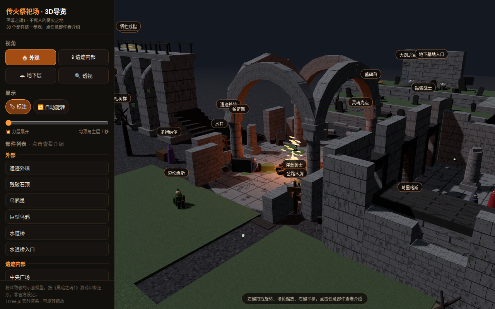
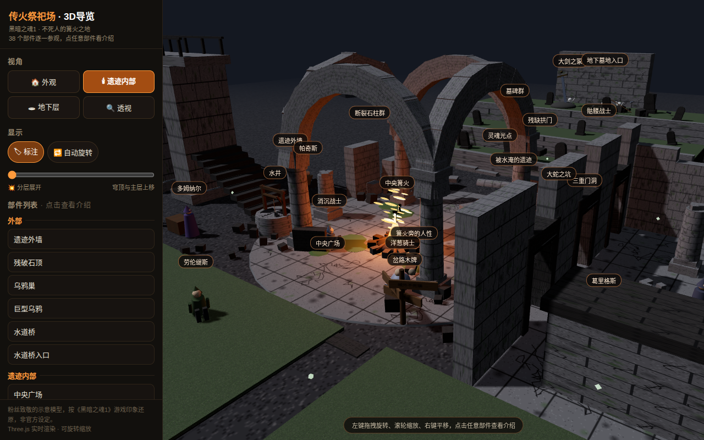

<p align="right"><a href="README.md">中文</a></p>

<p align="center">
  
</p>

<p align="center">
  <a href="https://holynova.github.io/firelink-shrine-ds1/">▶ Tour Online</a>
  ·
  <a href="https://github.com/holynova/firelink-shrine-ds1">GitHub Repository</a>
</p>

A Three.js 3D tour of Firelink Shrine from Dark Souls 1: the bonfire plaza, eastern ruins, graveyard, aqueduct and underground levels, laid out from the Fextralife Wiki and community maps. 38 clickable parts, each with a description and a camera fly-to. A fan tribute, not official. Zero build, pure JavaScript + Three.js.

## Screenshots

<p align="center">
  
  <br>
  
</p>

## Features

- **38 parts in 4 groups**: exterior 6 (遗迹外墙 ruins wall, 残破石顶 broken stone roof, 乌鸦巢 crow's nest, 巨型乌鸦 giant crow, 水道桥 aqueduct, 水道桥入口 aqueduct entrance), shrine interior 19 (中央篝火 central bonfire, 消沉战士 Crestfallen Warrior, 三重门洞 triple doorways, 佩特鲁斯一行 Petrus's party, 密室宝箱群 secret-room chests, 大剑之冢 Zweihander grave, 教区升降机井 parish lift shaft…), underground 4 (防火女囚室 Fire Keeper's cell, 骑士洛特里克 Knight Lautrec, 小隆德升降机 New Londo lift…), outdoors 9 (帕奇斯 Patches, 洋葱骑士 Siegmeyer, 葛里格斯 Griggs…).
- **4 view modes**: 外观 exterior / 遗迹内部 interior (south and east walls cut away) / 地下层 underground (roof lifted to reveal the Fire Keeper's cell and the New Londo lift) / 透视 X-ray (exterior walls turn translucent).
- **Exploded view**: a slider lifts the dome 6 m and the main level 3 m to separate the three layers.
- **Click any part** in the scene or the side list: a card shows its name, group and description, the camera flies to the best angle, and an orange box highlights it.
- **Controls**: drag to orbit, scroll to zoom, right-drag to pan; touch: one finger to orbit, pinch to zoom. Label and auto-rotate toggles.
- **Researched layout**: the bonfire sits slightly south, the well to the west, the triple doorways lead to three paths, the crow's nest crowns the eastern ruins roof, and the graveyard climbs the northern slope — sources in `REFERENCE.md` (Fextralife Wiki, community maps, a detailed Japanese map).

## Run Locally

Zero build — just serve it statically (ES modules need http(s), don't open with `file://` directly):

```bash
python3 -m http.server 8000
# Open http://localhost:8000
```

## Tech

- Three.js 0.160 (CDN import map) + OrbitControls; all geometry is generated in code — no external model files.
- Part system: `defPart()` defines 38 parts (name / group / description / viewing direction); picking one triggers `selectPart()` for a camera flight and highlight box; view modes toggle wall visibility and material transparency.
- Mobile-friendly: collapsible sidebar, touch-operation hints.

```
index.html          Entry: view buttons / explode slider / parts list / description card
app.js              All logic (~1200 lines): terrain and buildings / 38 parts / view modes / click-to-describe
REFERENCE.md        Layout sources: references, layout notes, v1 mismatch list, v2 modelling coordinate system
```
