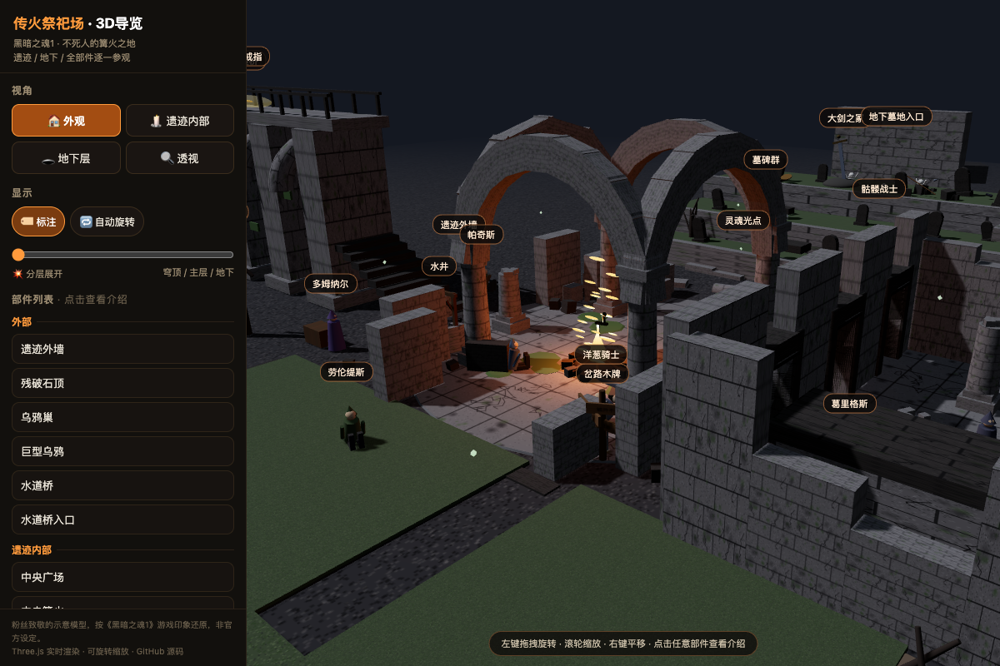

# Firelink Shrine DS1 3D / 传火祭祀场 · 黑魂1 3D导览

中文：基于 Three.js 制作的《黑暗之魂1》传火祭祀场 3D 立体空间导览。还原不死人的篝火遗迹、主建筑、地下祭坛与周边区域，支持外观、内部、地下层与透视多视角切换、分层展开、自动旋转与空间部件点击导览。

English: Interactive 3D walk-through of Firelink Shrine from Dark Souls 1 built with Three.js. Recreates the undead bonfire site, temple ruins, and subterranean chambers with exterior, interior, underground, and X-ray viewpoints, exploded layers, and landmark annotations.



## 在线体验 / Live Demo

- [Cloudflare Demo](https://xiaosang.cc/firelink-shrine-ds1/)
- [GitHub Repo](https://github.com/holynova/firelink-shrine-ds1)


## 本地运行 / Run locally

```bash
python3 -m http.server 8000
```

## 发布 / Deploy

```bash
npx wrangler deploy --config wrangler.jsonc
```

Cloudflare Workers · Domain: `xiaosang.cc` · Route: `/firelink-shrine-ds1/`

源码与部署配置使用同一个主分支（main）；在本地手动发布，不创建 Cloudflare 专用分支或 GitHub Action。
