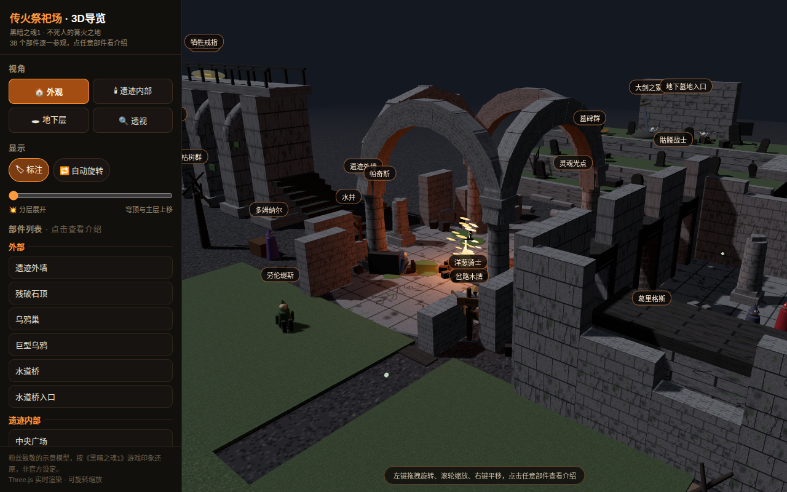
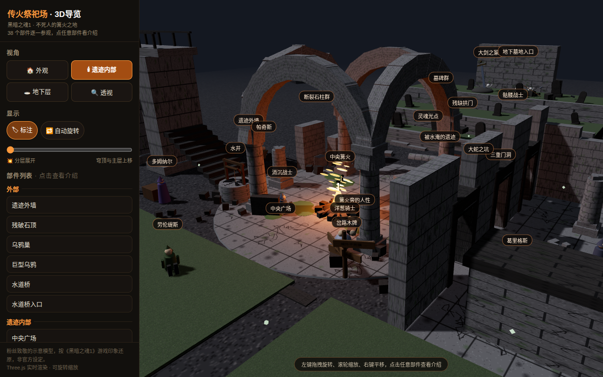

<p align="right"><a href="README.en.md">English</a></p>

<p align="center">
  
</p>

<p align="center">
  <a href="https://holynova.github.io/firelink-shrine-ds1/">▶ 在线导览</a>
  ·
  <a href="https://github.com/holynova/firelink-shrine-ds1">GitHub 仓库</a>
</p>

传火祭祀场是黑暗之魂 1 的 Three.js 3D 示意导览：按 Fextralife Wiki 与社区地图的布局，还原篝火广场、东废墟、墓地、水道桥与地下层，38 个部件逐一参观——点任意部件看介绍，相机自动飞过去。粉丝致敬作品，非官方设定。零构建，纯 JS + Three.js。

## 截图

<p align="center">
  
  <br>
  
</p>

## 功能

- **38 个部件，分 4 类**：外部 6（遗迹外墙、残破石顶、乌鸦巢、巨型乌鸦、水道桥、水道桥入口）、遗迹内部 19（中央篝火、消沉战士、三重门洞、佩特鲁斯一行、密室宝箱群、大剑之冢、教区升降机井……）、地下层 4（防火女囚室、骑士洛特里克、小隆德升降机……）、室外 9（帕奇斯、洋葱骑士、葛里格斯……）。
- **4 种视角**：外观 / 遗迹内部（切开南墙与东墙）/ 地下层（掀开顶盖看防火女囚室与小隆德升降机）/ 透视（外墙半透明）。
- **分层展开**：拖动滑块，穹顶上移 6 米、主层上移 3 米，三层结构拉开看。
- **点部件看介绍**：点 3D 场景里的任意部件，或点左侧部件列表，弹出名称、分类与介绍，相机自动飞到最佳观看位并用橙色框高亮。
- **漫游操作**：拖拽旋转、滚轮缩放、右键平移；移动端单指旋转、双指缩放；标注开关与自动旋转。
- **布局有据**：篝火略偏南、水井在西、三重门洞通三条路、乌鸦巢在东废墟屋顶、墓地是北边上坡——依据见 `REFERENCE.md`（Fextralife Wiki、社区地图、日文详图）。

## 本地运行

零构建，直接起一个静态服务器打开即可（ES Module 需经 http(s)，不要用 `file://` 直接打开）：

```bash
python3 -m http.server 8000
# 打开 http://localhost:8000
```

## 技术

- Three.js 0.160（CDN import map）+ OrbitControls；全部几何体由代码生成，无外部模型文件。
- 部件系统：`defPart()` 定义 38 个部件（名称 / 分类 / 描述 / 观看方向），点击拾取后 `selectPart()` 飞镜 + 高亮框；视角模式切换墙体可见性与材质透明度。
- 移动端适配：侧栏可收起、触屏操作提示。

```
index.html          入口：视角按钮 / 分层展开滑块 / 部件列表 / 介绍卡片
app.js              全部逻辑（约 1200 行）：地形与建筑 / 38 个部件 / 视角模式 / 点击介绍
REFERENCE.md        布局依据：参考来源、布局要点、v1 不符点清单、v2 建模坐标系
```
